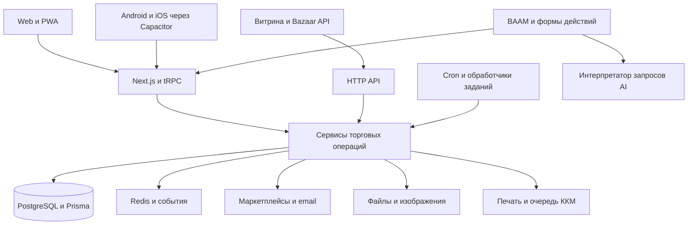

# Аудит bazaar и направления развития

Дата: 21 октября 2026 года, Asia/Bishkek. Код: `6aadb6c8947b82df7632fdd0ef4d82eddbd72e47`.

Bazaar уже содержит основу полноценной системы управления розничным магазином. Самая перспективная следующая стадия — связать существующие возможности в законченные процессы: самостоятельно подключиться и оплатить систему, быстро начать продажи, получать полезные подсказки, возвращать покупателей и управлять несколькими каналами без ручной сверки.

Первыми приоритетами должны стать согласованные тарифы и подписки, полезный BAAM на DeepSeek, надёжность интеграций и ежедневные задачи владельца. Новые крупные модули стоит выбирать после проверки потребностей действующих магазинов. Подробный список из 64 инициатив с зависимостями и критериями готовности находится в [программе улучшений](bazaar-growth-backlog-2026-10-21.md).

## Объём и границы проверки

В проекте обнаружены 97 файлов страниц, 62 обработчика HTTP API, 128 моделей Prisma, 118 миграций и 347 файлов тестов. Рассмотрены структура приложения, маршруты, схема данных, основные сервисы, интерфейсы ключевых сценариев, тарифы, BAAM, интеграции, мобильная архитектура, задания и CI. Для подписок, BAAM, прогнозов и нескольких незавершённых интеграционных цепочек выполнено углублённое чтение реализации. Это обзор всех основных подсистем с углублением в критические места, а не построчная сертификация каждого файла. [Карта проекта и результаты проверок](bazaar-growth-evidence-2026-10-21.json) сохраняют точный состав маршрутов, моделей и тестовых файлов.

Публичный лендинг проверен по доступной веб-версии. Авторизованные сценарии с реальными клиентскими данными, действующие договоры эквайринга, реальные платежи, оборудование и production-настройки не проверялись. Файлы с секретами не использовались. Поэтому наличие функции в коде ниже означает наличие реализации, а не подтверждение её работы у конкретного магазина.

## Продуктовая картина

Главное предложение bazaar можно сформулировать так: «Магазин продаёт, учитывает товар и возвращает покупателей из одной системы; владелец видит, что требует внимания, и может сразу действовать».

Здесь четыре связанных источника ценности:

1. **Повседневная работа:** касса, товар, остаток, закупка, возврат, смена.
2. **Продажи из разных каналов:** витрина, маркетплейсы, заказ по ссылке, единый доступный остаток.
3. **Повторные покупки:** клиентская база, лояльность, персональные предложения и работа продавцов.
4. **Управление:** достоверные отчёты, задачи, предупреждения и BAAM, который помогает выполнить работу.

Первые три уже имеют существенную основу в репозитории. Четвёртое направление пока разделено между отчётами, подсказками, журналами и несколькими поколениями BAAM.

Количество действующих магазинов, основные отрасли и повторяющиеся жалобы пока не установлены. Рабочая гипотеза для приоритизации — небольшая розница и сети из нескольких точек в Кыргызстане. Выбор между одеждой, косметикой, продуктовыми магазинами и другими отраслями должен опираться на реальные обращения: требования к размерам, срокам годности, весовым товарам и повторным покупкам сильно различаются.

## Устройство системы

Это модульное приложение на Next.js 14, React 18, TypeScript, tRPC, PostgreSQL/Prisma и Redis. Мобильные приложения загружают тот же интерфейс и добавляют доступ к возможностям устройства. Извлекать всё в микросервисы сейчас не требуется. Полезнее укрепить границы существующих сервисов, обработку событий и наблюдаемость.

### Что уже есть

| Подсистема | Реальная основа в коде | Что развивать |
| --- | --- | --- |
| Регистрация и доступ | Регистрация бизнеса, приглашения, подтверждение email, восстановление, роли и доступ к магазинам | Быстрый первый запуск, понятный trial, измерение активации |
| Организации и магазины | Несколько организаций, магазины, назначения сотрудников, ассортимент и источники каталога | Простое подключение следующей точки и управление сетью |
| Подписки | Три тарифа, ограничения, trial, заявки и панель владельца платформы | Оплата, продление, счета и жизненный цикл доступа |
| Товары | Варианты, упаковки, штрихкоды, единицы, категории, характеристики, фото | Ускорение ввода, полнота карточек, удобство массовых операций |
| Цены | Цены магазина и варианта, типы цен, скидки, снимки цен в заказах | Простые акции с контролем маржи и расписанием |
| Склад | Остатки и движения, поступления, перемещения, списания, пересчёты | Исключения, задачи и достоверная доступность по каналам |
| Закупки | Заказы поставщикам, статусы, частичная приёмка, PDF | Пополнение по данным и коммуникация с поставщиком |
| Касса | Черновики, отложенные чеки, смены, несколько способов оплаты, возвраты и долги | Меньше действий, подтверждённые платежи и подключение оборудования |
| ККМ | Очередь, connector API, попытки и восстановление | Реальный адаптер либо законченная поставка коннектора |
| Печать | PDF, ценники, настройки, QZ, маршруты коннектора | Настройка по модели устройства и честная диагностика готовности |
| Клиенты | Контакты, связь с заказами, база по магазинам | Единая история клиента там, где это нужно сети, сегменты и задачи продавцов |
| Лояльность | QR, регистрация, авторизация, балансы баллов, ledger, резервы и списания | Конверсия вступления, бонусные сценарии, повторные покупки |
| Email | Кампании, отправители, автоматизации по заказам, webhook, отписки и повторные доставки | Измеримые сценарии удержания и каналы, удобные местным покупателям |
| Витрина | Публикация каталога, карточки, корзина и создание заказа | Оплата, доставка/самовывоз и снижение трения оформления |
| Внешний API | Ключи магазина, товары, клиенты и заказы, серверные цены | События, инкрементальная синхронизация и удобство разработчиков |
| Маркетплейсы | M-Market, Bakai Store, O! Market, экспорты, проверки, задания и статусы | Общий центр состояния и проверенные возможности каждого канала |
| BAAM | Диалоги, голос, вложения, поиск, отчёты, формы и действия | DeepSeek, качество понимания и конкретные полезные сценарии |
| Аналитика | Продажи, возвраты, товары, себестоимость, кассовые операции и закрытие | Единые определения, качество исходных данных и ответы владельцу |
| Пополнение | Политики, формула заказа, прогноз и чтение снимков | Рабочее обновление прогнозов и учёт свежести |
| Мобильная работа | PWA, Capacitor, камера, deep links, native share и регистрация push | Завершённые события уведомлений и проверка устройств |
| Помощь | Руководство, контекстная помощь, подсказки и туры | Быстрое обучение на реальных задачах и снижение обращений |
| Эксплуатация | Журналы, метрики, health/preflight, фоновые задания, блокировки, dead letter, CI | Видимость клиентских сбоев, восстановление и контроль стоимости |

Основные точки входа: `src/app`, `src/server/trpc/routers/_app.ts`, `src/server/services`, `prisma/schema.prisma`, `src/server/jobs`, `src/components`, `src/lib/native`, `public/sw.js`.

### Что стоит сохранить

Уже есть полезные защитные механизмы: серверные цены и ограничения тарифов, разграничение магазинов во многих сервисах, аудит операций, идемпотентность, транзакции и блокировки склада, обработка повторных заданий. BAAM использует существующие бизнес-сервисы вместо самостоятельной записи в таблицы. Расчёты не нужно передавать языковой модели.

CI содержит не только unit-тесты, но и отдельные проверки с PostgreSQL/Redis, браузерные сценарии и сборку мобильных оболочек. Локальные unit-проверки не заменяют эти уровни, но эта основа позволяет улучшать продукт постепенно.

## Подтверждённые препятствия и пробелы

«Перед продажами» ниже означает препятствие для обещанного платного сценария. Это не оценка критичности каждой находки как инцидента безопасности.

| Код | Наблюдение | Последствие | Очерёдность |
| --- | --- | --- | --- |
| F01 | «Новичок» на лендинге включает кассу, но `STARTER.pos=false`; новые организации создаются на STARTER | Клиент не может попробовать обещанный основной сценарий | Перед продажами |
| F02 | Повышение тарифа — заявка и ручное одобрение; платежного жизненного цикла нет | Клиент не может самостоятельно оплатить и продлить подписку | Перед продажами |
| F03 | Для ACTIVE BUSINESS/ENTERPRISE дата окончания периода не ограничивает доступ; тесты прямо закрепляют ручное одобрение | Нельзя подключить списания и считать, что просрочки уже обработаны | Вместе с оплатой |
| F04 | `forecast.explain` проверяет организацию, но не назначение сотрудника магазину | Сотрудник может получить продажи другого магазина своей организации | Исправить до расширения |
| F05 | Читатели пополнения требуют `ForecastSnapshot`; запись снимков найдена в seed, но не в runtime или планировщике | Для новых рабочих товаров рекомендации могут отсутствовать; прежние снимки могут устаревать | Первая очередь |
| F06 | `forecastDemand` принимает `horizonDays`, но не использует его; дни строятся относительно серверного времени | Параметр горизонта не меняет расчёт; календарный контракт нуждается в уточнении | До обещаний умного прогноза |
| F07 | Основные вызовы BAAM жёстко используют `OPENAI_API_KEY` и OpenAI Responses endpoint | DeepSeek нельзя выбрать существующей настройкой | Первая очередь |
| F08 | В активном BAAM при неуверенности показываются три общие команды; аналитический `ask` существует отдельно от `send` | Запросы бизнеса часто превращаются в меню или общую форму | Первая очередь |
| F09 | `getKkmAdapter` возвращает stub для любого ключа | Режим прямого ADAPTER ещё не является действующей интеграцией | Перед обещанием автоматической ККМ |
| F10 | В серверном адаптере непредусмотренный PDF-путь печати заканчивается `printerConnectorNotImplemented` | Наличие настроек коннектора не гарантирует печать; QZ и PDF нужно оценивать отдельно | Первая очередь для магазинов с оборудованием |
| F11 | Есть APNs/FCM sender, но вызовы `sendMobilePushToUsers` в бизнес-процессах не найдены | Native push ещё не образует рабочую цепочку уведомлений | Первая очередь |
| F12 | Публичное оформление требует имя, email, международный телефон и целое количество | Возможное трение для покупателя; весовые количества не поддержаны этим контрактом | Проверить на выбранной отрасли |
| F13 | В футере ссылки Legal/Privacy ведут в WhatsApp, хотя `/privacy` существует | Клиент не получает ожидаемый документ перед оплатой | Перед продажами |
| F14 | Некоторые старые документы описывают прежний мобильный интерфейс и BAAM только для чтения | Дорожная карта рискует повторить уже выполненную работу | Во время подготовки спецификаций |

### Доказательства в реализации

- **F01:** `src/components/marketing/MarketingLanding.tsx:188`, `src/server/billing/planCatalog.ts:61`, проверки `feature: "pos"` в `src/server/trpc/routers/pos.ts:102`, создание STARTER в `src/server/services/signup.ts`.
- **F02–F03:** `src/server/services/billing.ts`, `src/server/trpc/routers/billing.ts`, `src/server/services/planLimits.ts:34`, `tests/unit/plan-limits.test.ts`. Модуль `src/server/billing/stripePreparation.ts` намеренно неактивен; это подготовка политики, а не подключённый Stripe.
- **F04:** `src/server/trpc/routers/forecast.ts:18`, зарегистрирован в `_app.ts:62`. Изолированный вызов настоящего router с синтетическим STAFF, магазином той же организации и отсутствующим grant вернул SUCCESS и прочитал `stockMovement`; проверка grants не вызывалась. База и реальные данные в воспроизведении не участвовали. Между разными организациями этот путь проверку выполняет.
- **F05–F06:** `src/server/services/reorderSuggestions.ts:13`, чтение снимков в `src/server/trpc/routers/inventory.ts` и `src/server/services/dashboard/summary.ts`; `prisma/seed.ts:472`; `src/server/services/forecasting.ts:66`; группы заданий в `src/server/jobs/schedule.ts`.
- **F07–F08:** `src/server/services/baamWorkflowIntent.ts:257`, `src/server/services/baamCompanion.ts:130`, `src/server/trpc/routers/baam.ts`, `src/components/use-baam-companion.ts:66`.
- **F09–F10:** `src/server/kkm/registry.ts`, `src/server/printing/adapter.ts:117` и `:164`. Для ККМ отдельно существует протокол локального коннектора — его наличие не устраняет заглушку прямого адаптера.
- **F11:** `src/server/services/mobilePush.ts:174`; поиск по `src` обнаруживает определение без потребителей.
- **F12–F13:** `src/app/api/public/catalog/[slug]/checkout/route.ts:10`, `src/components/marketing/MarketingLanding.tsx:581`.
- **F14:** сопоставление `docs/baam-assistant.md`, `docs/baam-fast-workflows.md`, `docs/bazaar-product-quality-audit.md` и текущих компонентов/сервисов. Старые аудиты полезны как история, но не как перечень незакрытых задач.

## Подписки и оплата

### Три разных денежных процесса

Подписка магазина на bazaar, оплата покупки конечным покупателем и бонусные баллы клиента должны иметь отдельные сущности и правила. Платёжный транспорт можно переиспользовать через адаптер, но события покупки не должны продлевать SaaS-подписку, а баллы не должны превращаться в денежный кошелёк без отдельного проектирования.

### Первый законченный сценарий

Владелец выбирает тариф → сервер создаёт счёт с фиксированными суммой и валютой → платёжная страница провайдера → сервер получает и проверяет результат → оплаченный счёт открывает конкретный период доступа → клиент видит срок, историю и возможность продлить подписку.

Сначала допустимо автоматизировать разовую оплату каждого периода. Это уже устраняет ручное одобрение. Регулярное автоматическое списание добавляется после подтверждения возможностей провайдера и согласия клиента. Обычная QR-оплата сама по себе не является согласием на регулярные списания.

Рекомендуемые сущности: `BillingAccount`, `Subscription`, `SubscriptionPeriod`, `Invoice`, `PaymentAttempt`, `ProviderEvent`, `EntitlementSnapshot`. Нужны версия цены, привязка к организации, уникальная связь с транзакцией провайдера и отдельное хранение результата сверки. Существующий `PlanUpgradeRequest` можно сохранить для индивидуальных условий.

### Правила доступа

Нужно различать пробный доступ, оплаченный период, льготный период после ошибки, отмену будущего продления и окончание доступа. Проверять только `plan + ACTIVE` недостаточно. При сбое провайдера уже оплаченный период продолжает действовать. Позднее или повторное уведомление не должно повторно продлевать срок либо отменять более новое состояние.

Возврат браузера на страницу успеха не подтверждает оплату. Подтверждением служит проверенный серверный результат и при необходимости запрос состояния у провайдера. Сумму, валюту и организацию берём из нашего счёта. Для webhook нужны проверка подписи, дедупликация, обработка порядка событий и регулярная сверка потерянных результатов.

После окончания срока требуется заранее определённое поведение: предупреждения, восстановление оплаты, доступ к истории и способ забрать данные. Нельзя случайно заблокировать сам экран оплаты или процесс восстановления. Текущий middleware уже делает исключение для `billing.*`, но правила нового модуля нужно проверить и для HTTP API.

### Провайдер

Для локального запуска стоит первым проверить Freedom Pay Кыргызстан: публичная документация описывает оплату, сохранение карт и уведомление о результате. Техническая возможность, договор, KGS, допустимость подписок и рекуррентов для конкретного мерчанта должны быть подтверждены до выбора реализации. Документация содержит и региональные примеры, поэтому нельзя переносить условия Казахстана на Кыргызстан. [Freedom Pay Merchant API](https://freedompay.kg/docs/merchant-api/intro), [описание платежей](https://freedompay.kg/docs/gateway-api/pay).

В репозитории уже есть неактивная подготовка Stripe с обсуждавшимся британским аккаунтом. Подтверждённый продавец и действующий аккаунт из неё не следуют. Этот вариант имеет смысл рассматривать только при наличии соответствующего бизнеса и возможности приёма нужных платежей. Архитектуру подписки следует отделить от выбора провайдера.

### Действующие бесплатные клиенты

Существующая подготовка Stripe предусматривает сохранение бесплатных условий старых бизнесов. Перед монетизацией нужно явно зафиксировать реальную политику, а не назначать платную группу по дате последнего входа или созданию нового магазина. Если сохраняем бесплатные условия, требуется постоянная запись группы и снимок прав. Чистые функции подготовки Stripe пока не обеспечивают такую защиту в production.

### Тарифы

Текущие цены в каталоге: 1 750, 4 375 и 8 750 KGS в месяц; возможны переопределения через окружение. Это существующие значения, а не подтверждённая готовность клиентов платить.

Для обсуждения предлагаю:

- Один магазин получает полный основной сценарий торговли: кассу, склад, клиентов и базовые отчёты. Базовый импорт полезен для запуска, выгрузка своих данных — для доверия.
- Следующий уровень продаёт удобство сети, интеграции, расширенную аналитику и автоматизацию.
- BAAM получает понятный включённый объём и контролируемые дополнительные расходы после измерения использования.

Сначала согласовать состав тарифов, trial и публичную страницу в одном каталоге. Отдельно проверить ценность лимитов по товарам: магазин с большим ассортиментом не обязательно имеет большой бюджет. Новые цены выбирать по интервью и платным пилотам.

## BAAM на DeepSeek

### Текущее состояние

В проекте сосуществуют две архитектуры. `baam.ask` и `baamAssistant.ts` дают ограниченный аналитический ответ с доказательствами. Активный интерфейс использует `baam.send` → `baamCompanion.ts` → распознавание намерения → формы и существующие бизнес-сервисы. Здесь уже есть сохранённые разговоры, смена магазина, голос, вложения, поиск и 49 адаптеров действий, описанных в `docs/baam-fast-workflows.md` и проверяемых контрактом `baam-workflows.test.ts`.

Поэтому задача — довести действующий помощник, сохранив полезную основу. Простые команды уже могут обрабатываться без модели. Свободная формулировка вызывает интерпретатор; финансовые значения рассчитывает сервер. При неуверенности активный путь часто предлагает одни и те же три команды, а отчётная ветка выдаёт ограниченный набор показателей. Это правдоподобное объяснение ощущения «не помогает», но частоту таких исходов нужно измерить на реальных запросах.

Документированные локальные ускорения старой реализации не являются текущим production-SLA. Число адаптеров и количество зелёных тестов тоже не измеряют полезность помощника.

### Что подключать

На дату проверки официальный API DeepSeek предлагает `deepseek-flash` и `deepseek-v4-pro`. Flash поддерживает изображения. Для первого пилота подходит Flash с ограниченным выводом и режимом без длительного reasoning для извлечения команды; Pro стоит сравнивать на сложных объяснениях только после измерения качества. [Модели DeepSeek](https://api-docs.deepseek.com/quick_start/pricing/), [изображения](https://api-docs.deepseek.com/guides/vision/).

DeepSeek сейчас поддерживает и Responses API. Переписывать всё на Chat Completions заранее не требуется. Но совместимость неполная: `developer` трактуется как `user`, `parallel_tool_calls=false` игнорируется, хранение состояния провайдера не поддерживается. В bazaar контекст передаётся в `developer`, а отключение параллельных вызовов уже используется. Нужен собственный адаптер контракта с серверным ограничением количества принимаемых действий, а не замена URL вслепую. [Совместимость Responses](https://api-docs.deepseek.com/guides/responses_api/).

Практический план:

1. Выделить `BaamTextProvider` с конфигурацией провайдера, модели, ключа, времени ожидания и лимитов.
2. Оставить общий валидируемый результат намерения и существующие формы. Политика разрешений принадлежит серверу.
3. Сохранить локальный путь для точных команд. Отдельно тестировать отрицания, исправления и неоднозначные названия.
4. Привести аналитические вопросы и действия к одному маршрутизатору возможностей, сохранив отдельные проверенные readers и определения метрик.
5. Добавить учёт токенов, стоимости, времени, результата и ошибки по организации без записи секретов в журналы.
6. Провести пилот на закрытом наборе запросов RU/KG и смешанной речи; сравнить с текущим поведением.

Текущая транскрипция вызывает OpenAI Audio отдельно. Подключение DeepSeek для текста не переключит распознавание речи. Для голоса нужен отдельный интерфейс ASR и отдельная проверка названий товаров, чисел, сомов и кыргызского языка. Изображения в нынешнем BAAM прежде всего прикрепляются к товарам; чтение накладной по фото будет новым сценарием.

### Пять первых полезных сценариев

| Запрос | Полезный результат | Что подтверждается человеком |
| --- | --- | --- |
| «Что сегодня требует внимания?» | Приоритизированные исключения со временем и источником: непринятые заказы, проблемы синхронизации, дефицит | Выбор следующего действия |
| «Прими эту накладную» | Черновик поступления: товары, количества, закупочные цены и выделенные неоднозначности | Сопоставление строк и проведение документа |
| «Почему выручка ниже?» | Разложение наблюдаемого изменения на чеки, средний чек, возвраты и товары | Переход к проверке; причинность не придумывается |
| «Что заказать поставщику?» | Объяснимый черновик закупки с остатком, ожидаемым приходом и свежестью расчёта | Количество, поставщик и отправка |
| «Подготовь предложение клиентам, которые давно не покупали» | Проверяемый сегмент, проект предложения и ожидаемые ограничения по марже | Аудитория, канал и запуск кампании |

Каждый сценарий проходит цепочку «понял → показал факты → подготовил → получил нужное подтверждение → выполнил → показал реальный документ». Подтверждение нужно соразмерно операции; простое открытие отчёта не требует дополнительного шага. Платёж, массовое изменение цен и рассылка требуют явного действия пользователя.

### Стоимость и критерии качества

По официальной странице Flash стоит за миллион токенов: input без cache $0.15 вне пика / $0.30 в пик; output $0.60 / $1.20. Пример расчёта, а не прогноз нагрузки: 2 000 входных и 500 выходных токенов на одну интерпретацию дают $0.0006–0.0012; 10 000 таких интерпретаций — $6–12. В примере нет дополнительных reasoning-токенов, ASR, обработки фото, повторов и инфраструктуры. Цена тарифа должна учитывать фактическую стоимость успешной задачи. [Тарифы DeepSeek](https://api-docs.deepseek.com/quick_start/pricing/).

Предлагаемые критерии пилота: минимум 150 заранее размеченных запросов на русском, кыргызском и смешанном языке; не менее 95% корректных определений для выбранных пяти сценариев; 100% отказов в тестах доступа и опасных неподтверждённых действий; отсутствие повторного проведения при повторах; p95 до 5 секунд для обычного текстового запроса как целевой показатель; снижение времени выполнения измеряемых задач относительно обычного интерфейса. Целевые значения ещё предстоит подтвердить пилотом, они не описывают нынешнее качество.

## Китайские продукты и применимые идеи

Здесь полезно заимствовать законченные процессы и способы сокращать работу магазина. Наличие функции у китайского поставщика не доказывает её коммерческий эффект в Кыргызстане. Ниже отделены наблюдаемые возможности источника и наша адаптация.

| Продукт и подтверждённый подход | Применение в bazaar | Очерёдность |
| --- | --- | --- |
| Youzan объединяет магазин, онлайн-канал, товары, клиентов и удержание | Покупка офлайн → QR-карта → личная витрина → следующая покупка с теми же правами и историей | P1 |
| Youzan даёт продавцу подготовить заказ и отправить клиенту на оплату | «Собрать заказ → отправить ссылку в мессенджер → клиент оплатил → продавец выдал» | P1 |
| Weimob связывает магазины, товар, заказы, участников программы и работу продавцов | Очередь задач продавца и единая картина исключений для владельца сети | P1/P2 |
| Shouqianba соединяет кассу, оплату, членство, акции и управление магазином | QR/ссылка на оплату с подтверждённым результатом и быстрым предложением вступить в лояльность | P1 |
| Dmall выделяет товарное планирование, снабжение и AI для решений магазина | Пополнение и перемещения с объяснимым расчётом, согласованием и оценкой результата | P2 |
| 2Dfire объединяет кассу, снабжение, сеть, клиентские программы и несколько каналов | Отраслевые наборы настроек и единые операции по каналу вместо отдельного островка интеграции | P2 |
| Youzan позиционирует AI как исполнителя конкретных операций и задач продавца | Пять специализаций BAAM с видимыми результатами и историей выполнения | P1/P2 |

Источники по строкам: [Youzan Retail](https://www.youzan.com/intro/lingshou), [заказ продавцом за клиента](https://help.youzan.com/displaylist/detail_46_46-2-86398), [Weimob Smart Retail](https://www.weimob.com/website/topic/retail), [Shouqianba Retail](https://www.shouqianba.com/zh/product/retail-saas-platform), [Dmall](https://www.dmall.com/), [2Dfire](https://2dfire.com/), [Youzan AI](https://www.youzan.com/ai).

WeChat-зависимые механики следует адаптировать под привычные нашим клиентам каналы, а не требовать от них установки китайской экосистемы. Возможные первые поверхности — web/PWA и ссылки из WhatsApp/Telegram. Официальную автоматизацию сообщений, доступность API и стоимость каждого канала проверяем отдельно; пока достаточно удобного ручного отправления подготовленной ссылки.

Групповые покупки, рефералы, комплекты и временные предложения можно проверять небольшими экспериментами. Сначала нужны корректные заказы, оплата, возвраты, ограничения скидок и измерение валовой прибыли. Копирование множества промомеханик без этого увеличит сложность и может съесть маржу.

## Самые сильные направления расширения

### Центр ежедневных задач

Вместо ещё одной страницы графиков владелец получает несколько задач с понятной ценой бездействия и ссылкой на решение. Первая версия может работать по правилам без AI: ошибка выгрузки, заказ без обработки, расхождение оплаты, незакрытая смена, остаток ниже порога. Затем BAAM объясняет и подготавливает действия.

Состояния «новое / назначено / решено / отложено», ответственный и дедупликация важнее красивого текста. Push и ежедневная сводка должны использовать этот же реестр, чтобы человек не получал несколько независимых уведомлений об одном событии.

### Продажи из мессенджера

Уже есть товары, цены, клиенты, API и онлайн-заказы. Нужен короткий мост: продавец собирает корзину, задаёт способ получения, отправляет ссылку, покупатель оплачивает или подтверждает самовывоз, магазин видит результат. Это более близкое расширение, чем собственный большой маркетплейс.

Оплату товаров принимаем от имени соответствующего магазина по согласованной схеме. Учёт, merchant credentials и webhook покупки отделяем от оплаты подписки на bazaar.

### Лояльность и работа с повторными покупками

Баллы уже реализованы. Следующий уровень — измерять путь от приглашения до следующей покупки: QR на чеке/кассе, быстрая регистрация, видимые права, понятное списание и восстановление после возврата. После этого — сегменты по давности и частоте покупок, поздравления, предложение подходящего товара и задачи продавцам.

Денежные депозиты, подарочные сертификаты и оплачиваемые клубные карты отличаются от баллов. Их следует вводить отдельными инициативами с учётом обязательств магазина и возвратов.

### Надёжная работа нескольких каналов

Интеграции уже есть; их следует объединить общей моделью результата: что синхронизируется, когда был успех, что отстаёт, сколько ошибок и какое действие требуется. M-Market full export имеет особые правила и cooldown; это не тот же контракт, что оперативное обновление цены/остатка в другом канале.

Нужны журнал внешних операций, постоянные идентификаторы, проверка расхождений, доступный остаток после резервов и лимиты каждого канала. Если поставщик не даёт импорт заказов или webhook, честно показываем доступную функцию. Маркетинговое обещание «все каналы в реальном времени» сейчас шире того, что можно установить по одному набору экспортов и заданий.

### Товары и закупки с минимальным вводом

Сканирование штрихкода, фото, шаблон отрасли, предложение категории и черновик описания могут ускорять создание карточки. Отдельно полезны импорт накладной и устранение дублей. Нужно показывать уверенность сопоставления и не переносить характеристики похожего товара автоматически.

Для пополнения сначала завершить обычный расчёт на достоверных данных. Учитывать отсутствие товара на полке, возвраты, сроки поставки, упаковки, минимальную партию и ожидаемый приход. Нулевые продажи не означают нулевой спрос. AI может объяснить расчёт и заполнить черновик, но не должен угадывать объёмы закупки.

### Финансовая ясность

Страницы `/finance/income` и `/finance/expense` сейчас перенаправляют к кассовым внесениям/изъятиям. Это не самостоятельный управленческий учёт расходов и доходов. Полезное расширение — категории расходов, обязательства поставщикам, платежный календарь и валовая прибыль с качеством себестоимости.

Разные отчёты уже имеют разные определения. Например, исторические line-margin графики и отчёт с возвратами нельзя подписывать одним словом «прибыль» без пояснения. В BAAM `sourceCompleteness` остаётся `unknown`; до сверки источников помощник не должен заявлять, что все продажи бизнеса учтены.

## Инженерная программа для роста

1. **События и задания.** Сохранить нынешние блокировки и durable-состояния. Для новых подписок и внешних действий использовать постоянную очередь событий/outbox и идемпотентность на стороне назначения. Текущие Redis-события не заменяют постоянный журнал доставки.
2. **Скорость.** Измерять p50/p95 поиска, добавления в чек, проведения, выдачи остатков и ответа BAAM. Ускорять подтверждённые узкие места; справочники можно кешировать, расчёт денег и остатка требует определённых правил свежести.
3. **Модули.** Крупные сервисы `pos.ts` (~6 920 строк), `emailMarketing.ts` (~5 440), `products.ts` (~4 883) и маркетплейсы усложняют изменения. Выделять части по операциям во время работы с ними; общий переписанный backend сейчас не является первым приоритетом.
4. **Доступ.** Исправить подтверждённый forecast-путь и проверить соседние readers по той же матрице: организация → магазин → роль → тариф. Для внешних ключей — отдельные области разрешений, ротация и журнал использования.
5. **Восстановление.** Проверить восстановление backup на отдельной базе, инструкции при отказе Redis, зависших заданиях, ошибке ККМ и неясном результате платежа. Зелёный health не подтверждает возможность восстановиться после аварии.
6. **Эксплуатация клиента.** Собрать видимые ошибки конкретного магазина, состояние доставки писем и интеграций, версию приложения и запросы с request ID. Добавить ограниченный по правам диагностический пакет.
7. **Мобильная работа.** Native-оболочки зависят от доступности размещённого интерфейса. Offline-продажи пока не реализованы. Начать с честного состояния сети и сохранения неподанных черновиков; автономные продажи требуют отдельного протокола синхронизации и проверки денег/остатков.
8. **Данные и AI.** Определить, какие поля покидают систему для интерпретации, ASR и чтения фото. Новый сценарий накладной передаёт больше данных, чем нынешний текстовый классификатор; минимизацию и сроки хранения проектировать для каждого сценария.

## Очерёдность реализации

Это последовательность проверки и поставки, а не обещание сроков команды, состав которой неизвестен.

| Этап | Результат | Условие перехода |
| --- | --- | --- |
| 1. Условия продажи | Единый тарифный каталог, работающий trial, политика действующих клиентов, выбранный способ оплаты | Клиент может пройти обещанный основной сценарий; опубликованные условия соответствуют серверу |
| 2. Платный запуск | Разовая оплата периода, verified callback, история счетов, сверка и восстановление доступа | Испытаны успех, отказ, повтор, потерянное/позднее событие и отмена |
| 3. Полезный BAAM | DeepSeek-адаптер и несколько измеряемых сценариев с реальными документами | Пройден набор языковых, бизнес- и permission-проверок; есть сравнение с обычным интерфейсом |
| 4. Ежедневная ценность | Центр исключений, push, исправленное пополнение и состояние интеграций | Владелец получает полезные задачи, а повторные события не создают шум |
| 5. Рост продаж магазина | Заказ по ссылке, оплата покупателем, лояльность и один сценарий удержания | Есть сквозное измерение заказа, повторной покупки и возврата |
| 6. Отраслевое расширение | Наборы для выбранной отрасли, сеть, более сложные закупки или offline | Потребность подтверждена магазинами и платными пилотами |

Без подтверждённого спроса отложить собственный большой маркетплейс, «универсального автономного директора», полноценную бухгалтерию, микросервисы ради архитектуры и сложные промо без измерения маржи. Доступные идеи остаются в программе, но не конкурируют за первый запуск.

## Метрики результата

| Направление | Что измерять |
| --- | --- |
| Подключение | Доля регистраций, дошедших до первого товара, поступления и завершённой продажи; время до первой пользы |
| Подписка | Trial → первая подтверждённая оплата; успешность продления; неоплаченные счета; фактически полученная выручка |
| Удержание магазина | Доля магазинов с полезной недельной активностью; прекращение использования и причины |
| BAAM | Доля завершённых задач, исправлений и отказов; время и стоимость успешной задачи; регулярные повторные пользователи |
| Торговля | Время чека, ошибки проведения, отложенные/брошенные заказы, подтверждённые платежи |
| Каналы | Возраст данных, очередь, ошибки, расхождения и время восстановления |
| Клиенты магазина | Конверсия QR-регистрации, следующая покупка, использование бонусов, эффект кампании относительно контрольной группы |
| Надёжность | Ошибки ключевых операций, p95, восстановление заданий, успешное восстановление backup |

Число ACTIVE организаций, умноженное на цену тарифа, является оценкой MRR по статусам, а не подтверждённой денежной выручкой. После подключения оплаты эти показатели нужно разделить.

## Выполненные проверки

| Проверка | Результат |
| --- | --- |
| `pnpm exec tsc --noEmit --incremental false` | PASS |
| `pnpm exec next lint` | PASS, без предупреждений |
| `pnpm i18n:check` | PASS |
| Выбранные BAAM и Stripe preparation unit-тесты через `vitest.stabilization-unit.config.ts` | 6 файлов, 229 тестов PASS |
| Изолированный вызов `forecastRouter` с синтетическим STAFF без grant | Дефект доступа воспроизведён |

В выбранные тесты вошли `baam-workflows`, `baam-assistant`, `baam-question-scope`, `baam-audio`, `baam-route-access` и `stripe-preparation`. Они подтверждают свои контракты на текущем коде, но не качество DeepSeek или реального ASR. Полный DB-набор, production-сборка и авторизованный браузерный прогон в этом ознакомительном запуске не выполнялись. Продуктовый код, тарифы, данные и внешние ресурсы не менялись.

## Решения для следующего рабочего запуска

Первые конкретные спецификации: подписка с оплатой и сохранением условий действующих клиентов; BAAM на DeepSeek с выбранными сценариями; единая очередь ежедневных исключений. Перед их реализацией уточнить отрасль первых платящих магазинов, частые жалобы, продавца/мерчанта для эквайринга и желаемые бесплатные условия. Эти сведения меняют состав первого релиза, но не отменяют подтверждённые исправления тарифов, доступа и незавершённых цепочек.
