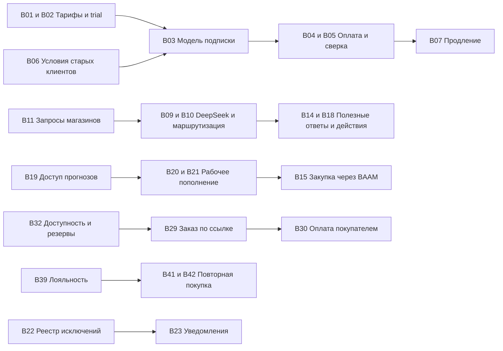

# Программа улучшений bazaar

Дата: 21 октября 2026 года. Основание: [аудит проекта](bazaar-growth-audit-2026-10-21.md), код `6aadb6c8947b82df7632fdd0ef4d82eddbd72e47`.

Это исходный список по результатам аудита. Выполненные изменения и результаты проверок ведутся в [журнале playground](playground-progress.md).

64 инициативы ниже объединяют исправления, завершение существующих модулей и новые возможности. Это набор для выбора последовательных релизов. Наличие инициативы здесь не означает, что её надо включить в первый релиз.

Приоритеты: **P0** — необходимо для согласованного платного запуска либо исправления подтверждённого доступа; **P1** — первая очередь ежедневной пользы и удержания; **P2** — расширение после проверки спроса; **P3** — отдельный крупный эксперимент. Относительный объём: **S** — локальное изменение, **M** — один процесс, **L** — несколько подсистем, **XL** — самостоятельная программа. Это сравнительная оценка сложности, не срок и не смета. Каждый L/XL следует разложить перед реализацией.

## Подписки и начало продаж

| ID | Инициатива | Приоритет и объём | Существующая основа | Зависимости и проверяемый результат |
| --- | --- | --- | --- | --- |
| B01 | Единый каталог тарифов для лендинга, приложения и серверных прав | P0 M | `planCatalog.ts`, billing UI, отдельный массив `MarketingLanding` | Решить состав тарифов. Тариф с обещанной кассой реально допускает POS; цены и ограничения совпадают на всех поверхностях. Отдельно учесть индивидуальные права старых клиентов. |
| B02 | Пробный период с доступом к основной ценности | P0 M | Регистрация на STARTER, trial и onboarding | B01. Новый бизнес без ручного повышения проводит товар → поступление → продажу; окончание trial объясняется заранее. Не выдавать временные возможности постоянным изменением тарифа. |
| B03 | Постоянная модель подписки, счёта и периода доступа | P0 L | Поля Organization и ручные заявки | B01, политика старых клиентов. Счёт имеет фиксированную цену/валюту и принадлежит бизнесу; оплаченный период вычисляется однозначно, повторная обработка не меняет результат. |
| B04 | Самостоятельная онлайн-оплата подписки | P0 L | Платёжный модуль отсутствует; Stripe preparation неактивен | B03, подтверждённый мерчант и sandbox. Клиент оплачивает период через hosted checkout и видит результат. Сервер выбирает сумму, тариф и return URL. Сначала можно без автосписания. |
| B05 | Проверка событий оплаты и сверка с провайдером | P0 L | Идемпотентность, задания и журналы уже есть | B03–B04. Успех, отказ, дубликат, задержка и потерянный callback обработаны; неверные подпись, сумма, валюта и организация отвергаются; неопределённый результат попадает на сверку. |
| B06 | Сохранение условий действующих клиентов | P0 M | Чистые функции `stripePreparation.ts` | Явная политика владельца. Если старые бизнесы остаются бесплатными, сохраняются группа и снимок прав; добавление магазина, сотрудника или устройства не включает оплату. Проверить равенство прав до/после миграции. |
| B07 | Продление, отмена, неуспешная оплата и льготный период | P1 L | ACTIVE/PAST_DUE/CANCELED и ручные даты | B03–B05. Просрочка подчиняется согласованным правилам; отмена будущего продления не отнимает оплаченный период; доступ к оплате и восстановлению сохраняется. Автосписание — только при готовности провайдера и согласии. |
| B08 | Публичные условия, политика и прозрачные контакты | P0 S | `/privacy`, футер с WhatsApp | Подтверждённые реквизиты и правила покупки/отмены. Ссылки открывают нужные документы; на оплате видны продавец, цена, период и способ обращения. Тексты проверяются владельцем бизнеса. |

## BAAM и DeepSeek

| ID | Инициатива | Приоритет и объём | Существующая основа | Зависимости и проверяемый результат |
| --- | --- | --- | --- | --- |
| B09 | Адаптер DeepSeek для текста BAAM | P1 M | OpenAI Responses в `baamWorkflowIntent` и `baamAssistant` | Ключ и небольшой тестовый бюджет. Выбор провайдера через серверную настройку; проверены схема, таймаут, отказ и неожиданные несколько вызовов. Сначала Flash; не менять остальные AI-модули одновременно. |
| B10 | Единый выбор между вопросом, поиском, помощью и действием | P1 L | Отдельные `ask`, `send`, readers и workflow | B09. Вопрос «как сделать» не проводит операцию; аналитический вопрос не подменяется тремя общими кнопками; исправление продолжает нужный документ. Старые контракты сохраняются до проверки миграции. |
| B11 | Проверка полезности на реальных формулировках | P1 M | Много unit-тестов, но они не измеряют ежедневную пользу | Пять сценариев и примеры от магазинов. Не менее 150 размеченных RU/KG/смешанных запросов; отчёт об ошибках, времени и стоимости; сравнение с обычным интерфейсом. Это критерий выбора модели. |
| B12 | Независимое распознавание речи | P1 M | OpenAI Audio, проверка файлов, voice UI | B11. Отдельная настройка ASR; проверены местные названия, числа, отрицания и сомы. Перед действием пользователь видит исправляемую транскрипцию; смена текстовой модели не отключает голос. |
| B13 | Накладная по фото в черновик поступления | P1 L | Вложения, фото товаров, поступления и workflow | B09/B11, отдельные правила передачи фото. Товары сопоставляются с каталогом, неуверенные строки выделены; итоги сверены, повтор не проводит документ повторно. Начать с одного формата поставщика. |
| B14 | Объяснение изменений продаж с переходом к первичным данным | P1 M | Проверенные sales readers и ссылки отчёта | B10. Чеки, средний чек, возвраты и товары объясняют наблюдаемое изменение за указанные даты; неизвестная себестоимость остаётся неизвестной. Причины поведения покупателей не выдумываются. |
| B15 | Черновик закупки через BAAM | P1 L | Reorder policy, формула пополнения, purchase order adapters | B20–B21. Помощник показывает остаток, ожидаемый приход, расчёт и свежесть; пользователь утверждает количество и поставщика. Начать с min/max, если прогноз ещё не валидирован. |
| B16 | Учёт стоимости и лимиты AI по бизнесу | P1 M | Логи длительности и размера запроса | B09. Сохраняются provider/model, token usage, стоимость, результат и задержка; включённый объём понятен клиенту. Платный повтор не скрывается; простые формы не вызывают модель без необходимости. |
| B17 | Полномочия и подтверждения действий BAAM | P1 M | Роли, свежая авторизация, audit, idempotency и workflow | B10, для каждого нового инструмента. Подмена организации, магазина, ID и назначения отвергается. Массовые изменения и внешние отправки требуют явного подтверждения; повтор возвращает исходный результат. |
| B18 | Понятный результат и восстановление незаконченной задачи | P1 M | Карточки форм, статусы исполнения, история | B10–B11. Вместо непонятного ожидания показан этап работы; ошибка сохраняет заполненные поля; после успеха виден настоящий документ. Удалённый/отменённый диалог не даёт позднему ответу выполнить действие. |

## Надёжность повседневных операций

| ID | Инициатива | Приоритет и объём | Существующая основа | Зависимости и проверяемый результат |
| --- | --- | --- | --- | --- |
| B19 | Закрыть доступ к прогнозу неназначенного магазина | P0 S | Настоящий `forecastRouter.explain`, дефект воспроизведён | Применить ту же проверку store grants, что в других readers; определить нужные роль/тариф. Отказ происходит до чтения движений. Проверить разрешённый магазин и чужую организацию. |
| B20 | Рабочее обновление прогнозов и контроль свежести | P1 M | `ForecastSnapshot`, readers, seed и jobs | B19. Runtime-задача создаёт/обновляет снимки для рабочих товаров; есть время расчёта, версия, источник, срок годности и повтор без дублей. Устаревший снимок не выдаётся как актуальный совет. |
| B21 | Определённая модель прогноза и календарь Кыргызстана | P1 M | Bootstrap daily series, пока неиспользуемый horizon | B20. Объяснить смысл горизонта, дни Asia/Bishkek, возвраты, пустую историю и stockout; фиксировать seed для сравнения моделей. Проверить прогноз на отложенном периоде, а не только формулу. |
| B22 | Центр ежедневных исключений и задач | P1 L | События, отчёты, low-stock, jobs, BAAM | Выбрать 5–7 сигналов. Каждая задача имеет магазин, основание, ответственного, действие и статус. Повтор одного события не создаёт новые задачи; решённые исключения не остаются красными. |
| B23 | Полезные push и сводки владельцу | P1 M | Устройства, APNs/FCM sender; бизнес-вызовы не найдены | B22. Заказ/сбой/дефицит создаёт доставляемое уведомление со ссылкой; учтены права, часовой пояс, тихие часы, повторы и недействительный токен. Первое доказательство — реальное устройство. |
| B24 | Подтверждённые платежи и сверка кассы | P1 L | Учёт методов оплаты, providerRef, split payment и смены | Согласованный банк/эквайер. Отдельно показывать «кассир отметил» и «провайдер подтвердил». Возвраты и поздние результаты сверяются с первоначальной продажей; сбой не создаёт дубль оплаты. |
| B25 | Законченная интеграция ККМ | P1 L | FiscalReceipt queue и connector API; прямой adapter stub | Выбранное оборудование/провайдер. Продажа, повтор, возврат, offline-коннектор и восстановление подтверждены на устройстве. Интерфейс не предлагает неготовый ADAPTER как подключённый. |
| B26 | Мастер подключения принтера и диагностика | P1 M | PDF, QZ, настройки и неподключённые connector-пути | B25 при общей поставке оборудования. Выбор устройства → проверка связи → тестовый чек/ценник → сохранение. Готовность подтверждается пробной печатью, а не наличием device ID. |
| B27 | Подключение магазина до первой продажи | P1 M | Onboarding, импорт, help, туры | B01–B02. Один понятный маршрут: магазин, несколько товаров/импорт, остаток, касса, первая продажа. Видно место остановки; измеряется время до пользы. Демо-данные не смешиваются с рабочими. |
| B28 | Очередь проблем товарного каталога | P1 M | Категории, характеристики, штрихкоды, фото, preflight интеграций | Выбрать отрасль. Показывать дубли, пустые данные, ошибки единиц, отсутствующие фото/характеристики и последствия для каналов. Исправление ведёт в нужное поле; AI предлагает, человек проверяет. |

## Онлайн-продажи и интеграции

| ID | Инициатива | Приоритет и объём | Существующая основа | Зависимости и проверяемый результат |
| --- | --- | --- | --- | --- |
| B29 | Заказ по ссылке из мессенджера | P1 L | Клиенты, цены, онлайн-заказы, витрина | B32 и способ получения. Продавец собирает заказ и вручную делится защищённой ссылкой; покупатель видит состав, цену и срок. Заказ защищён от чужой правки и повторного оформления. Китайский ориентир — Youzan assisted order. |
| B30 | Онлайн-оплата покупки на витрине | P2 L | Checkout сейчас создаёт заказ | B29/B32, merchant-схема магазина. Покупка оплачивается в пользу соответствующего магазина; её ledger отделён от подписки bazaar. Есть обработка отказа, возврата, истечения срока и позднего успеха. |
| B31 | Самовывоз, доставка и статус исполнения | P2 M | CustomerOrder, email статусов | B29. Покупатель выбирает доступный способ и слот/адрес; магазин видит задачи выдачи. В первой версии допустима ручная доставка; подключение службы доставки — отдельный адаптер. |
| B32 | Единая доступность и резервы для каналов | P1 L | Остаток, статусы заказов, on-order и snapshots | Описать текущую семантику резервов. Один последний товар не продаётся в нескольких каналах сверх согласованной политики. Неоплаченный резерв имеет срок и освобождение; POS-продажи в минус регулируются отдельно. |
| B33 | Единый центр состояния интеграций | P1 M | Раздельные preflight, jobs и статусы маркетплейсов | Матрица функций по провайдерам. Показать время последнего успеха, объём, отставание, ошибки и повтор. Экспорт файла не обозначается как двусторонняя непрерывная синхронизация. |
| B34 | Постоянные события и очередь доставки изменений | P1 L | Redis events, jobs, idempotency, dead letter | B33. Изменение товара/остатка и событие фиксируются согласованно; сбой после commit не теряет изменение. Учитываются cooldown канала, пакетирование, повтор и сверка назначения. |
| B35 | Webhook и инкрементальная синхронизация Bazaar API | P2 L | Store-bound API keys, timestamps и cursor заказов | B34/B58. Клиент читает изменения после курсора и получает подписанные события с повторами; есть versioning и журнал доставки. Право чтения товаров не даёт управление заказами автоматически. |
| B36 | Удобный обмен с бухгалтером и существующим учётом | P2 M | CSV/XLSX/PDF, исторические цены и себестоимость | Реальный образец от клиента, например выгрузка для 1С. Один проверенный формат со сверкой итогов и валют; сначала экспорт, затем двусторонний обмен при спросе. Не заявлять универсальную совместимость. |
| B37 | Небольшой набор управляемых акций | P2 L | Процентные скидки, bundles и расписания | B54, маржинальные ограничения. Начать с комплекта или второй единицы со скидкой; порядок применения, возврат и снимок скидки однозначны. Эффект оценивается по прибыли и повтору, не только обороту. |
| B38 | Более простое оформление заказа | P1 M | Публичный checkout требует email/телефон и integer qty | Метрики воронки и отрасль. Проверить необходимость email, дать подходящий запасной контакт; для весового сценария поддержать согласованную точность. Не уменьшать требования через обход серверной проверки. |

## Лояльность и повторные покупки

| ID | Инициатива | Приоритет и объём | Существующая основа | Зависимости и проверяемый результат |
| --- | --- | --- | --- | --- |
| B39 | Короткий путь от QR до следующей покупки | P1 M | Loyalty join/card, OTP, баллы, ledger и POS | Измерить потери регистрации. Покупатель быстро вступает, видит баланс и использует его; возврат корректирует начисления и списания. Доказать сценарий на кассе и телефоне без помощи разработчика. |
| B40 | История одного клиента в сети магазинов | P2 L | Сейчас контакты и заказы во многих местах store-scoped | Явная политика идентичности и доступа. Одинаковый телефон не вызывает безусловное слияние. Есть preview, конфликт, аудит объединения и правила видимости магазинам; POS/лояльность не теряют историю. |
| B41 | Сегменты клиентов по давности и частоте покупок | P1 M | Клиенты и завершённые продажи | B54, при необходимости B40. Объяснимые сегменты «новый», «повторный», «давно не покупал» с доступными первичными заказами. Порог соответствует отрасли, отменённые продажи не засчитываются. |
| B42 | Один автоматизированный сценарий удержания | P1 L | Email automation и кампании | B41, consent/канал, B22. Сначала одна цепочка возвращения клиента с ограничением частоты, отпиской и контрольной группой. Помощник готовит текст; запуск выполняется по утверждённому правилу. |
| B43 | Купоны с управляемой экономикой | P2 M | Скидки и loyalty ledger | B37/B54. Выдача, срок, условия, лимит использования и возврат определены сервером. Нельзя применить один купон дважды из параллельных заказов; стоимость акции видна магазину. |
| B44 | Реферальная программа магазина | P2 M | Клиенты, ссылки и лояльность | B39/B43. Награда начисляется за завершённую квалифицирующую покупку; само-приглашение и отмена не дают постоянную награду. Измеряются новые платящие покупатели и стоимость привлечения. |
| B45 | Задачи продавцов по работе с клиентами | P2 L | Роли, клиенты, задания как будущее B22 | B41/B22. Продавец получает согласованный список контактов, историю и проект предложения; фиксирует результат. Переход сотрудника не теряет отношения клиента с магазином. Ориентир — Weimob/Youzan guided selling. |
| B46 | Подарочные сертификаты и оплачиваемые клубные права | P3 L | Баллы есть; денежный сертификат отдельной моделью не подтверждён | Подтверждённый спрос и отдельные правила обязательств/возвратов. Остаток, частичное использование, срок и возврат сверяются; денежный номинал не записывается как обычные бонусные баллы. |

## Закупки, деньги и управление сетью

| ID | Инициатива | Приоритет и объём | Существующая основа | Зависимости и проверяемый результат |
| --- | --- | --- | --- | --- |
| B47 | Категории расходов и понятный результат магазина | P2 L | Cash drawer PAY_IN/PAY_OUT, отчёты; finance-страницы — redirect | B54. Аренда, доставка, комиссии и прочие расходы не смешиваются с любым изъятием наличных. Показывать валовую и выбранную управленческую прибыль с определёнными правилами периода. |
| B48 | Обязательства перед поставщиками и календарь платежей | P2 L | Поставщики и purchase orders | Определить признание долга по приёмке/счёту. Видны сроки, частичные оплаты, кредитовые корректировки и связь с документом. Возврат поставщику меняет обязательство объяснимо. |
| B49 | Возраст долгов покупателей и задачи взыскания | P2 M | POS debts и погашения | B22, выбранная отрасль. Долги сгруппированы по срокам, платежи не дублируются; напоминания согласованы магазином. Редактирование продажи не переписывает историю погашения без следа. |
| B50 | ABC/XYZ, медленный товар и сезонность | P2 M | Sales reporting, каталог и остатки | B54, достаточная история. Ясно различать вклад в выручку/маржу, изменчивость продаж и отсутствие товара. Отчёт показывает период и критерий; даёт проверяемое действие, а не ярлык «плохой товар». |
| B51 | Обмен заказом и накладной с поставщиком | P2 L | PO PDF, приёмка, email и будущая B13 | Выбранный поставщик-пилот. Он получает заказ, подтверждает количество/дату, присылает накладную; магазин проводит отклонения. Сначала защищённая web-ссылка, сложный EDI — по спросу. |
| B52 | Предложение перемещения между точками | P2 L | Transfers, store stock, reorder | B20–B21/B32. Система предлагает переместить избыток до внешней закупки с учётом доступности и стоимости перевозки; человек утверждает. Отправка и приёмка видимы обеим точкам. |
| B53 | Согласования и персональные лимиты операций | P2 L | RBAC, audit и статусы документов | Выбрать реальные полномочия сети. Скидка, возврат, списание или закупка выше порога требуют утверждения назначенным человеком. Есть замещение, причина отказа и защита от самосогласования там, где это нужно. |
| B54 | Единые определения финансовых показателей | P1 M | `reporting/sales`, `analytics`, `salesAnalytics`, BAAM metrics | Утвердить продажи/возвраты/прибыль/период/канал/валюту. Одинаковые показатели сверяются либо честно различаются названием; неизвестная себестоимость и полнота данных не превращаются в ноль. |

## Эксплуатация и дальнейшее расширение

| ID | Инициатива | Приоритет и объём | Существующая основа | Зависимости и проверяемый результат |
| --- | --- | --- | --- | --- |
| B55 | Поддержка по состоянию конкретного магазина | P1 M | Request ID, metrics, jobs, diagnostics и support bundle | Определить доступ поддержки и скрытие данных. Видны ошибки клиента, email, синхронизация и затраты; есть понятная инструкция восстановления. Диагностический пакет не содержит секретов или лишних контактов. |
| B56 | Бюджеты скорости ключевых действий | P1 M | Профилирование hot paths и логи slow procedure | Снять реальную базовую линию. Измерять p95 поиска, добавления в чек, проведения и BAAM; нагрузка соответствует ассортименту клиента. Оптимизировать найденный запрос, а не все страницы заранее. |
| B57 | Проверенное восстановление и аварийные процедуры | P1 M | Health/preflight, migrations и recovery | Доступ к отдельной тестовой инфраструктуре. Backup восстановлен и сверены ключевые записи; описаны потеря Redis, зависшая задача, неизвестный платёж и отказ оборудования. Обозначены целевые RPO/RTO. |
| B58 | Единая проверка полномочий новых интеграций | P1 M | Store access helpers и API keys | B19, новые интерфейсы B35/B40. Матрица organization/store/role/feature покрывает readers и writes; ключи имеют ограниченные scopes и ротацию. Проверяется отзыв прав во время долгой задачи. |
| B59 | Постепенное разделение крупных сервисов | P2 L | Крупные POS, products, email и marketplace services | Проводить в ходе изменений, сохраняя поведение. Выделять checkout/returns/pricing и delivery без полного переписывания. Контракты и значимые транзакционные проверки проходят до и после. |
| B60 | Сохранение неподанных черновиков при плохой сети | P1 M | Состояние сети, PWA/native, retry и idempotency | Ограничить типы данных и их срок. Черновик сохраняется локально для текущей учётной записи; после связи перепроверяются цены, права и остаток. Неподанный чек не называется завершённой продажей. |
| B61 | Полноценные автономные продажи | P3 XL | Серверные операции offline отклоняются | Подтверждённая боль и отдельная спецификация. Локальные идентификаторы, оплата, фискализация, часы, конфликты, отзыв устройства и синхронизация проходят отказные сценарии. Не считать это небольшой настройкой service worker. |
| B62 | Отраслевые наборы запуска | P2 M | Настраиваемые поля, категории, варианты, lots и печать | Данные первых платящих отраслей. Два магазина выбранной отрасли запускаются с меньшим числом ручных настроек. Одежда — размер/цвет; продукты — вес/партии; косметика — сроки/повтор. Не делать всё одновременно. |
| B63 | Весы, электронные ценники и дополнительные устройства | P3 L | Barcode scanner, QZ, печать, native shell | B26, спрос и доступное устройство. Один протокол доведён до установки/диагностики/обновления; ценник использует ту же эффективную цену, что касса. Покупка оборудования требует отдельного решения. |
| B64 | Предзаказ или групповая покупка | P3 L | Bundles, заказ, клиенты, витрина | B29–B32/B37, один магазин-пилот. Определены минимальный объём, срок, отмена и возврат при несобранной группе; измеряется дополнительная прибыль. Китайские механики проверяем локально небольшим экспериментом. |

## Что брать в первый пакет

Первый пакет подготовки: **B01, B02, B06, B08 и B19**. Он исправляет обещания, определяет условия старых клиентов и закрывает подтверждённый доступ. Параллельно по смыслу можно готовить спецификации **B03–B05** и набор пользовательских примеров **B11**; выполнение зависит от доступной команды.

Первый оплачиваемый релиз: **B03–B05** плюс минимальная часть **B07**. Готовность определяется успешным самостоятельным подключением и восстановлением при ошибках, а не появлением кнопки «Оплатить».

Первый полезный релиз BAAM: **B09–B11, B14, B16–B18**. В нём должен быть один основной оперативный сценарий, выбранный по частоте обращений, и аналитические вопросы. **B13** добавлять, если накладные — реальная ежедневная боль. **B15** зависит от исправленного пополнения и не должен опережать **B20–B21**.

Первое расширение роста: **B22–B23, B29, B33, B38–B39 и B41–B42**. Здесь нужно выбрать одну цепочку целиком, например «заказ по ссылке → получение → карта → повторная покупка», вместо нескольких незавершённых интерфейсов.

## Зависимости крупных направлений

## Как выбирать следующую инициативу

Сначала обязательные условия оплаты и подтверждённые дефекты. Затем сравнивать частоту боли, число затронутых магазинов, наблюдаемую экономию времени/потерь, готовность платить, зависимости и стоимость поддержки. Численные баллы имеет смысл назначать после интервью, а не придумывать сейчас.

Для каждой выбранной инициативы записать владельца результата, сценарий до/после, доступы, интеграционные ограничения, событие успеха и способ отката. Завершение — подтверждённая задача пользователя с данными и обработкой ошибок. Следующий модуль начинается после этого результата либо при независимой подтверждённой потребности.
