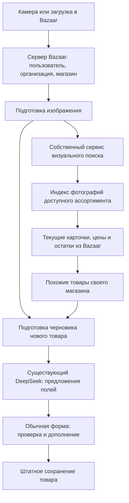

# Поиск и создание товаров по фотографии: архитектура Bazaar

Дата: 14 ноября 2026 года. Статус: **предлагаемая архитектура до реализации**. Решения опираются на изученные китайские проекты и существующий код Bazaar. Модели на ассортименте Bazaar пока не испытывались; показатели ниже — критерии будущей проверки, а не достигнутые результаты.

## 1. Задача и порядок развития

Первый выпуск помогает найти **уже существующий товар в выбранном магазине Bazaar** по снимку с камеры или загруженной фотографии. Поиск доступен на всех тарифах без дополнительной платы. Сохраняются действующие права просмотра товаров и доступа к магазинам.

Второй выпуск помогает **подготовить новый товар по фотографиям**: сначала найти возможный дубль, затем предложить поля в проверяемом черновике и сохранить товар через обычную форму Bazaar. Он использует тот же механизм визуального поиска и уже подключённый DeepSeek.

Поиск предложений на 1688, Taobao, Pinduoduo и Poizon — самостоятельный будущий этап. Доступ к ним, их ключи и бесплатные лимиты не являются зависимостью внутреннего поиска. Проверка прямого 1688 отложена после уточнения задачи пользователем.

## 2. На какие профессиональные реализации опираемся

Здесь разделены готовый код, описание промышленной системы и документация коммерческого продукта. Наличие публичного репозитория не означает подтверждённую пригодность для Bazaar.

| Источник | Что действительно изучено | Что перенимаем |
| --- | --- | --- |
| Baidu / [PaddleClas, PP-ShiTu](https://github.com/PaddlePaddle/PaddleClas/tree/202ac79a99aa368f2c95cb1871bbc11574f685da) | `deploy/python/predict_system.py`, `build_gallery.py`, китайские инструкции по поиску и управлению галереей. Код Apache-2.0 | Готовые модели выделения товара и извлечения признаков; отдельная подготовка галереи; готовый Faiss для поиска; несколько ракурсов и порог сходства |
| [Chinese-CLIP](https://github.com/OFA-Sys/Chinese-CLIP/tree/31863c707501bf1605d36842f43deb78793dbc5d) | README и интерфейсы готовых моделей; MIT по metadata GitHub | Альтернативный готовый кодировщик для сравнительного испытания, особенно для сочетания изображения и китайского текста |
| Zilliz / [Milvus reverse image search](https://github.com/milvus-io/bootcamp/tree/b2be8cc8308ec33c0cf957929b4f208d85b758a9/applications/image/reverse_image_search) | README, `server/src/encode.py`, `main.py`, `operations/search.py`; Apache-2.0 | Разделение извлечения признаков, поиска и получения бизнес-данных по идентификаторам. Это учебное приложение, а не готовый сервис с организациями и правами Bazaar |
| Alibaba / Xianyu, [IPL: Intelligent Product Listing](https://arxiv.org/html/2410.16977v1) | Статья авторов Alibaba и Fudan: архитектура, поиск похожих товаров, атрибуты, эксплуатация и ошибки | Подтверждённый авторами промышленный сценарий «фото → похожие товары и сведения → редактируемое описание». Это публикация об устройстве системы; готового исходного кода IPL в проверенных материалах не найдено |
| [1688-product-manage](https://github.com/next-1688/1688-product-1688-product-manage/tree/fa31af26479e8d80cad596aa0ed3195739c93bc2) | Описание процесса, `references/02-01-category.md`, `references/04-00-draft.md` | Группировка фотографий одного товара, работа с допустимой схемой полей, отдельный черновик, возобновление после ошибки, различие сохранения черновика и публикации. Его инструменты Accio/Ali1688 не переносим в Bazaar |
| Alibaba Cloud, [Product Image Search](https://www.alibabacloud.com/help/en/image-search/user-guide/add-images) | Официальная модель загрузки и идентификации изображений | Разделение товара и его фотографий, выделение области товара, обновление изображения с сохранением идентичности, фильтры. Используем как образец устройства; покупать этот сервис не предлагается |

В PP-ShiTu уже есть точный поиск Faiss FLAT, обновление галереи и извлечение признаков. В исследованном коде удаление не поддерживается для его варианта HNSW32. Поэтому выбор приблизительного индекса по умолчанию из демонстрации нельзя автоматически переносить в магазин, где товары и фотографии удаляются.

В IPL авторы соединяют поиск похожих товаров с генерацией описания и отдельно разбирают отсутствие результатов и тайм-ауты. Для Bazaar это обосновывает общую визуальную основу двух функций. Мы адаптируем этот подход к своей модели данных и существующему DeepSeek; воспроизводить обучение их собственной большой модели на старте не требуется.

У `next-1688` в исследованном репозитории не установлена явная лицензия на код. Его описание служит образцом процесса. Слепое копирование также перенесло бы чужие правила — например, автоматический выбор первой категории; для справочников Bazaar это не обосновано.

## 3. Что уже есть в Bazaar

| Готовая часть | Точки переиспользования | Граница |
| --- | --- | --- |
| Карточка и фотографии | `Product.photoUrl`, `ProductImage`, варианты товара | Основная и дополнительные фотографии должны участвовать в поиске; вариант не равен отдельному новому товару |
| Загрузка и преобразование | `productImageClientUpload.ts`, `productImageUpload.ts`, `productImageSourceUpload.ts`, `productImageStorage.ts` | Сохранить камеру, HEIC, нормализацию и существующие механизмы хранения |
| Безопасное чтение изображений | `productImageFetch.ts` | Ограничения размера, пикселей, времени и безопасная работа с адресами изображений |
| Доступ | `auth/token.ts`, `storeAccess.ts`, `productAccess.ts`, `products/read.ts` | Пользователь и организация подтверждаются сервером; правила ассортимента берутся из существующей системы |
| Текущие цены и остатки | `products/read.ts`, `storeSellingPrice.ts`, `effectiveProductPrice.ts`, форматирование валют | Поисковый индекс не становится источником цены, себестоимости или остатка |
| Анализ фото | `aiProvider.ts`, `productSpecSuggestions.ts`, `productDescriptions.ts`, `prepareStudioPhotoAnalysis` | DeepSeek уже подключён; есть согласие на передачу данных, бюджетирование и учёт расходов |
| Форма и сохранение | `product-form.tsx`, `products/mutations.ts`, `products.ts` | Сохранить валидацию, права, проверку штрихкодов, обязательность полей и идемпотентность |
| Длительные операции | PostgreSQL-модели заданий, lease/dedupe в `productImageStudio.ts` и `productDescriptionGenerationJobs.ts`; Redis locks | Переиспользовать проверенные приёмы. `keepBackgroundTaskAlive` сам по себе не является долговечной очередью |

Полного механизма внутреннего визуального поиска и полного процесса «фото → черновик товара» в проверенном коде пока нет.

## 4. Общая схема

Это схема зависимостей, а не автоматический переход из поиска к созданию. Обычный поиск заканчивается выдачей. Обращение к DeepSeek и создание черновика происходят по отдельному действию пользователя.

### Предлагаемые технические решения

1. **Next.js остаётся единственной публичной точкой входа.** Здесь сессия, права, выбранный магазин, нормализация ответов и существующая бизнес-логика. Модель не получает полномочий менять товары.
2. **Один внутренний CPU-сервис обработки фотографий.** Первый кандидат — готовые модели PP-ShiTu; Chinese-CLIP — кандидат для сравнения. Модель прогревается при запуске, её файлы фиксируются по версии и контрольной сумме. Поисковый запрос не скачивает модель из интернета.
3. **Готовый Faiss, точный поиск FLAT для первой версии.** Предварительно нормализованные признаки сравниваются готовой библиотекой; [официальная документация Faiss](https://github.com/facebookresearch/faiss/wiki/MetricType-and-distances) описывает связь inner product и косинусного сходства. Финальный набор модели, размерность и порог выбираются после сравнительного испытания.
4. **PostgreSQL хранит привязки, признаки, версии и задания.** Faiss-индекс — восстанавливаемое представление этих данных. Для старта не требуется новая большая база Milvus или обязательное расширение pgvector в рабочей БД.
5. **Redis отвечает за ограничение нагрузки и краткоживущие блокировки/кэш.** Удаление кэша не должно уничтожать единственный экземпляр признаков или терять задания.
6. **Изображения товара продолжают храниться существующим способом.** Поисковый снимок обрабатывается временно; он не становится автоматически фотографией товара. Для возобновляемых черновиков потребуется защищённое временное хранение с ограниченным сроком.

Таким образом, новая инфраструктурная часть — сервис визуальной обработки. Его HTTP-обработчики и потребитель заданий могут работать из одного образа; при нагрузке их можно разделить без изменения продукта. Отдельная разработка модели, алгоритма ближайших соседей или универсального AI-агента не входит в задачу.

### Границы интерфейсов

Это логические операции; конкретные URL и схемы фиксируются после выбора модели.

| Операция | Вход | Результат и ответственность |
| --- | --- | --- |
| Поиск в магазине | Магазин, фото/область товара, идентификатор запроса | Только разрешённые идентификаторы и карточки; охват индекса, версия поиска, признак неполной выдачи. Организация определяется сессией |
| Состояние подготовки | Доступный магазин | Число готовых/ожидающих/ошибочных фотографий и возможность повтора, без данных других магазинов |
| Создать/обновить черновик | Магазин, принадлежащие пользователю материалы, ручные поля, ревизия | Сохранённый черновик; существующие поля товара ещё не меняются |
| Предложить поля | Черновик и ожидаемая ревизия входа | Идентификатор задания, затем предложения с происхождением. Генерация не является сохранением товара |
| Сохранить товар | Подтверждённые поля, ревизия черновика, ключ идемпотентности | Настоящий идентификатор товара либо обычная ошибка бизнес-правил; повтор возвращает прежний результат |

Внутренний сервис получает только разрешённые байты/ссылки на материалы и контекст индекса, возвращает признаки либо кандидатов. Он не решает, кому разрешён магазин, сколько стоит товар и можно ли создать запись.

Передача фотографии через HTTP POST остаётся операцией чтения для бизнес-политик. Поиск не должен случайно унаследовать `ensureActivePlan` для tRPC-mutation или потребление AI-квоты; требуется сохранить доступ к чтению, который уже есть у организации. Ограничение вычислительной нагрузки выполняется отдельно. Создание товара продолжает проходить действующие проверки записи и количества товаров.

### Отбор модели до её включения

Сравнить готовый PP-ShiTu и один альтернативный кодировщик на одинаковой выборке Bazaar: разные ракурсы, фон, освещение, упаковка, визуально близкие варианты. Проверить качество, CPU/RAM, время прогрева, архитектуру процессора и условия конкретных весов. Код под открытой лицензией не заменяет проверку выбранного набора весов.

PP-ShiTu — предпочтительный исходный кандидат из-за готового товарного процесса. Это рекомендация к испытанию, а не утверждение, что он уже точнее альтернатив на нашем ассортименте. JS/ONNX-исполнение можно рассмотреть, если оно измеримо упрощает размещение и даёт сопоставимое качество; зависимости в приложение до этого выбора не добавляются.

## 5. Подготовка индекса и его актуальность

Индексирование выполняется заранее и по изменениям фотографий. Нельзя заново скачивать и обрабатывать весь каталог при каждом поиске.

1. При изменении фотографии транзакция сохраняет запись и событие для обработки. Тот же механизм покрывает импорт, замену, удаление и изменение основной фотографии. Backfill существующих изображений идёт отдельными возобновляемыми пакетами.
2. Обработчик получает конкретный идентификатор принадлежащего организации изображения, безопасно читает файл, вычисляет хеш содержимого, готовит изображение и извлекает признаки.
3. Повторная доставка события безопасна: ключ включает организацию, источник фотографии, версию её содержимого, версию модели и подготовки. Устаревший обработчик не может записать результат поверх новой фотографии.
4. Вектор и состояние сохраняются в PostgreSQL; затем обновляется поколение поискового индекса. Неуспешное задание повторяется ограниченно и остаётся видимым в состоянии подготовки.
5. Готовое поколение публикуется атомарно. Начатая перестройка не делает частичный индекс «полностью готовым». Предыдущую версию можно сохранить для восстановления, но её результаты всё равно проходят текущую проверку доступа.

Признаки фотографии хранятся один раз внутри организации. Индексы первой версии строятся для пары **организация + магазин** из активного ассортимента. Изменение состава магазина обновляет состав индекса, но не требует повторного анализа тех же изображений.

Каждый индекс имеет `modelVersion`, `preprocessVersion`, `catalogRevision`, `generation`, число готовых/ожидающих/ошибочных изображений. Запрос сравнивает нужную и опубликованную ревизии. При расхождении использует только свежий разрешённый набор через точный поиск либо сообщает о подготовке; молчаливый поиск в произвольном старом составе недопустим.

При смене модели строится новое поколение. Векторы от разных моделей или способов подготовки не сравниваются. Старый индекс удаляется после успешного переключения и проверки восстановления.

Для малых магазинов точный индекс собирается из сохранённых признаков и держится в ограниченном кэше. Для больших сначала измеряются память и задержка: исходная матрица занимает примерно `число фото × размерность × 4 байта` для float32, плюс накладные расходы. Кэш нескольких магазинов ограничивается общим бюджетом памяти. Переход к HNSW/IVF, pgvector или Milvus рассматривается после измерения; интерфейс сервиса позволяет заменить backend.

## 6. Сценарий «найти в своём магазине»

Вход — отдельная кнопка «Найти по фото» рядом с поиском в разделе товаров. Она отличается от уже существующего сканера штрихкодов. Если магазин не выбран, пользователь выбирает один из доступных магазинов. Первая версия ищет во всём активном ассортименте указанного магазина и явно показывает это в окне поиска.

1. Пользователь снимает или загружает изображение. Доступны предпросмотр, замена и выделение области товара через существующий компонент кадрирования. Для нескольких предметов предлагается выбрать один.
2. Сервер повторно подтверждает сессию, организацию и доступ к магазину; проверяет файл, убирает EXIF/GPS и ограничивает размеры. Идентификатор организации из запроса не принимается как источник полномочий.
3. Сервис извлекает признаки изображения и ищет среди фотографий актуального разрешённого ассортимента. Основная фотография, галерея и связанные фотографии вариантов учитываются. Несколько совпадений одного товара объединяются; найденный ракурс можно показать рядом с основной фотографией.
4. Сервер повторно отбирает доступные активные карточки по полученным идентификаторам и получает текущие сведения через существующие правила чтения товаров и цен. Стоимость закупки и себестоимость не попадают в новый публичный контракт выдачи.
5. Пользователь видит несколько кандидатов: фотография, название, артикул при включённом поле, действующая цена и остаток магазина. Валюта и скидки показываются теми же средствами, что в списке товаров.

Сходство не является доказательством идентичности SKU или варианта. Выдача называется «Похожие товары»; непроверенный score не отображается как «вероятность 98%». Размер, цвет, фасовка и штрихкод могут требовать проверки человеком. Поиск не выбирает товар автоматически для продажи и не меняет остаток.

Сохраняется прежнее поведение списка: обычные клики по строке/названию не открывают карточку. Явные действия используют существующие иконки, локализованные доступные названия и подсказки. Позже тот же поиск можно включить в подбор товаров при приёмке или продаже, отдельно проверив эти процессы и сохранив их компоновку.

### Состояния и восстановление

| Ситуация | Поведение |
| --- | --- |
| Фото ещё не выбрано | Камера, загрузка и короткая подсказка по съёмке |
| Идёт поиск | Прогресс, возможность отменить, защита от повторной отправки |
| Индекс готов частично | Показать охват и что подготовка продолжается; доступные результаты помечены как неполная выдача |
| У товаров нет фотографий | Объяснить причину; предложить обычный поиск. Добавление фото доступно только при соответствующих правах |
| Нет достаточно похожих кандидатов | Честное пустое состояние; повторная съёмка/кадрирование и текстовый поиск |
| Часть фотографий повреждена | Не блокировать исправные изображения; показать неполный охват и возможность повторить обработку |
| Модель, очередь или хранилище недоступны | Понятная ошибка и повтор; обычный поиск продолжает работать |
| Смена пользователя, организации, магазина или снимка | Отменить старый запрос и очистить его результаты; поздний ответ не отображается |

## 7. Сценарий «создать товар по фотографиям»

Предлагаемый процесс перенимает этапность китайских реализаций, а поля и сохранение оставляет Bazaar.

**Фотографии одного товара → возможные дубли → предложения полей → обычная форма → сохранение.**

1. Пользователь с действующим правом создания товара выбирает магазин и добавляет несколько фотографий одного товара. Стартовое предложение — до пяти: общий вид, этикетка/упаковка, нужные детали. Разные товары не смешиваются в один черновик.
2. Внутренний поиск показывает возможные существующие карточки. Можно использовать найденную либо продолжить создание новой. Сходство не запускает автоматическое объединение и не меняет найденный товар.
3. DeepSeek получает изображения, допустимые поля и доступные справочники. Возвращает ограниченный структурированный результат. Сведения из похожей карточки являются отдельной подсказкой с происхождением, а не фактом о новом предмете.
4. Предложения открываются в существующей форме. Редактируемые пользователем значения имеют приоритет; поздний ответ AI их не перезаписывает. Неизвестные обязательные данные запрашиваются в контексте формы.
5. При сохранении сервер повторно проверяет права, магазин, действующие правила создания, обязательные поля, конфликты штрихкодов и идемпотентность. Сохраняется настоящий товар через существующий сервис; повторный клик не создаёт вторую карточку.

| Поле | Допустимое поведение |
| --- | --- |
| Название и описание | Предложение, основанное на изображении и подтверждённых данных; доступно редактирование |
| Категория | Кандидаты из справочника Bazaar, выбор/подтверждение в форме. Категории 1688 не становятся нашим справочником автоматически |
| Цвет, бренд, модель, текст упаковки | Предложение с указанием источника; скрытые характеристики остаются неизвестными |
| Материал, состав, сертификаты, совместимость | Заполнять только при видимом или подтверждённом основании; внешний вид не подтверждает состав |
| Штрихкод | Существующая библиотека распознавания и серверная проверка конфликтов; модель не выдумывает код |
| Артикул и единица измерения | Существующие генерация и справочники Bazaar; модель не создаёт новые записи справочников самостоятельно |
| Цена, закупочная стоимость, остаток | Ввод/подтверждённый источник пользователя. Цена на чужой этикетке не становится автоматически ценой магазина |

Предложение поля хранит значение, происхождение и состояние: предложено, подтверждено или исправлено. Не вводим неподтверждённые численные «уверенности» модели. Сохранение черновика не является созданием остатка, закупки или публикацией на маркетплейсе. Первоначальные остатки, если пользователь их явно вводит, проходят существующий отдельный бизнес-процесс.

### Черновик и длительная генерация

Нужна отдельная сущность черновика, допускающая незаполненные обязательные поля; не создавать незавершённые записи `Product`, чтобы обойти валидацию. В ней — организация, магазин, автор, исходные материалы, принятые значения, предложения, ревизия входа и состояние операции.

Генерация выполняется возобновляемым заданием. Если пользователь меняет фото или поля, результат от старой ревизии становится устаревшим. Повтор сохраняет введённые данные. При отказе DeepSeek или отсутствии согласия остаются фотографии и обычная ручная форма. Черновики и их материалы недоступны по произвольному идентификатору или общей публичной ссылке.

Поиск не требует DeepSeek. Автозаполнение использует существующие согласие на передачу фото, бюджет и учёт расходов DeepSeek; новая платная посредническая подписка не нужна. Условия доступности автозаполнения и его бесплатного объёма нужно определить отдельно от безусловно бесплатного внутреннего поиска, до обещаний в интерфейсе.

## 8. Данные и границы доступа

Предлагаемые новые сущности — концептуальная модель, не готовая Prisma-миграция:

| Сущность | Назначение |
| --- | --- |
| Признаки фотографии | Организация, товар/вариант, ссылка на разрешённый источник, версия/хеш содержимого, модель и подготовка, вектор, состояние |
| Задание обработки | Организация, источник и его ревизия, dedupe key, попытки, lease, ошибка, следующее выполнение |
| Состояние индекса магазина | Организация и магазин, нужная/готовая ревизия, поколение, модель, охват и ошибки |
| Черновик по фото | Организация, магазин, автор, материалы, предложения/принятые поля, ревизия и результат сохранения |

Организация входит в связи и уникальные ключи новых сущностей. Индекс, кэш, временные объекты и задания также разделяются по организации. Сессия берётся с сервера и перепроверяется; смена роли или отозванный доступ не обходятся старым токеном или кэшем.

Поиск разрешён ADMIN, MANAGER, STAFF и CASHIER в пределах уже доступных им товаров и магазинов, на всех тарифах. Создание и изменение товара сохраняют действующие ограничения роли; наличие доступа к поиску не даёт STAFF/CASHIER право создавать карточки. Начальные остатки при создании доступны только ADMIN, как в текущем `products.create`. Права владельца организации обрабатываются существующими правилами Bazaar.

Ассортимент для ранжирования ограничивается магазином до выбора лучших кандидатов. Финальная проверка доступности обязательна даже для свежего индекса. Поиск «во всех организациях → отфильтровать первые десять» недопустим: он и смешивает данные, и теряет релевантные разрешённые результаты.

Состояние ассортимента берётся из тех же правил, что в обычном активном списке товаров. Архивные и локально исключённые записи не возвращаются; нулевой остаток сам по себе не скрывает активный товар. Роль не получает новых возможностей изменения карточек или просмотра закупочных сумм благодаря поиску.

Запросы CPU-сервиса доступны только серверу Bazaar, содержат ограниченные данные и контекст нужного индекса. Клиент не задаёт путь к файлу, имя коллекции или произвольный адрес для скачивания. Используются существующие безопасные чтение и преобразование изображений; raw payload и фотографии не записываются в прикладные логи.

Поисковые снимки по умолчанию живут в памяти до завершения запроса. Для возобновляемого черновика предлагается защищённое временное хранилище и срок семь дней с очисткой отменённых/просроченных материалов; это новая предлагаемая политика, а не описание текущей реализации. Сохранённые фотографии товара далее подчиняются обычной политике Bazaar. Текущий публичный адрес товарного изображения нельзя автоматически считать подходящим механизмом хранения приватного черновика.

## 9. Нагрузка, ошибки и стоимость

Бесплатно для пользователя означает отсутствие тарифного барьера и оплаты каждого поиска. Серверные CPU, память и хранение имеют себестоимость; они контролируются подготовкой признаков один раз, общим прогретым экземпляром модели, пакетной обработкой и ограничением одновременной работы.

Лимиты защищают ресурсы и одинаковы для всех тарифов. Отдельно ограничиваются пользовательские поиски и тяжёлая первичная индексация; одна организация не должна занимать всю очередь. Числа задаются после нагрузочного испытания и возвращаются с понятным временем повтора. Существующее право читать товар не отзывается из-за отсутствия AI-бюджета: обычный визуальный поиск его не использует.

Сервис имеет readiness после прогрева модели. Для запроса есть общий deadline, тайм-аут чтения файла и ограничение ожидания исполнения. Фоновые задания используют lease, ограниченные повторы и восстановление после остановки процесса. Истечение HTTP-запроса не выдаётся за отрицательный результат поиска; неизвестный результат сохранения проверяется по идемпотентному ключу.

Метрики: охват индексом, очередь и возраст заданий, ошибки чтения, время подготовки/поиска, холодный запуск, CPU/RAM, расходы генерации и доля исправленных AI-полей. Общие показатели не должны раскрывать ассортимент другой организации. Порог сходства и версия модели наблюдаемы, но фотографии и чувствительное содержимое не требуются в логах.

## 10. Как доказываем качество

До интеграции в основной интерфейс нужен воспроизводимый стенд. Тестовые данные — изолированные, синтетические либо предоставленные для испытания; рабочую клиентскую БД не заполняем и не сбрасываем.

Начальная цель — не менее 200–300 товаров нескольких типов, отдельные галерейные и поисковые снимки, похожие варианты и предметы, которых в каталоге нет. Проверка одним и тем же файлом с обеих сторон недостаточна.

| Проверка | Начальный критерий, подлежащий подтверждению |
| --- | --- |
| Поиск известного товара | Правильная карточка среди первых пяти минимум в 90% контрольных случаев; отдельно разобрать ошибки размера/цвета/упаковки |
| Неизвестный предмет | Оценить ошибочные сильные совпадения и выбрать порог на отложенной выборке; не обещать «точное совпадение» |
| Охват | Не менее 95% поддерживаемых исправных фотографий обработаны; причины пропусков видны |
| Скорость | Цель p95 до 2 секунд на прогретом сервисе и до 5 секунд целиком на согласованном стенде; замерять отдельно сеть и ожидание очереди |
| Актуальность | Цель индексации обычного изменения до 60 секунд при штатной нагрузке; удалённое/недоступное исключается текущей серверной проверкой |
| Автозаполнение | Проверять поля по отдельности, долю исправлений, сохранение ручного ввода и отсутствие вымышленных цен/остатков; универсальный процент «качества AI» не вводить |

Для приложения обязательны реальные интеграционные проверки PostgreSQL/Redis: другая организация с той же фотографией, чужой и отозванный магазин, все разрешённые роли, все тарифы, архив/скрытие/удаление, изменение изображения во время задания, рестарт и повторная доставка. Отдельно проверяются валюты, действующие скидки на границах дат, остатки, защита черновиков и идемпотентное создание.

Интерфейс проверяется на desktop/mobile для RU/KG/EN: камера/загрузка, кадрирование, прогресс, частичный индекс, пустая выдача, ошибка/повтор, смена магазина и поздний ответ. Автотесты используют контролируемые ответы DeepSeek; отдельный явно обозначенный опыт на реальной локальной модели подтверждает визуальный поиск. Типы, lint, переводы и production build входят в проверку реализации.

## 11. Этапы реализации и критерии перехода

| Этап | Результат | Условие завершения |
| --- | --- | --- |
| A. Проверка технической основы | Изолированный сравнительный стенд PP-ShiTu и альтернативы; замеры и выбранные версии | Качество, лицензии весов и ресурсы подтверждены; записан выбор модели и лимитов |
| B. Внутренний поиск | Индексация своего ассортимента, бесплатный API, окно поиска в товарах | Проверены права, организации, магазины, актуальность, состояния и desktop/mobile; нет вызовов платных поисковых API |
| C. Черновик товара | Существующий поиск дублей + DeepSeek + обычная форма + возобновление | Проверены происхождение полей, обязательные данные, сохранение ручных правок, бюджет и однократное создание |
| D. Другие процессы магазина | Поиск в подборе товара при операциях | Каждый процесс проверен отдельно; установленные рабочие компоновки сохранены |
| E. Внешние предложения | Независимые адаптеры китайских площадок | Отдельно подтверждены доступ, условия и качество; внутренний поиск работает независимо |

Сначала выполняется A, затем B. C использует результаты B и не должен задерживать выпуск работающего внутреннего поиска. Сроки и серверную стоимость оцениваем по стенду, а не по необоснованному обещанию «готово за несколько дней».

В будущем внешнее предложение имеет собственные источник, внешний идентификатор, валюту, время получения и ссылку. Оно не подменяет `Product` или остаток магазина. Импорт в Bazaar — отдельное действие с проверкой и созданием черновика. Общее у направлений — приём изображения и интерфейс результатов; данные, полномочия и операции остаются раздельными.

## 12. Что меняется относительно предыдущего прототипа

Выключенный HioBuy-прототип — историческая работа, а не реализация этой архитектуры. При переходе на внутренний поиск нужно убрать его обязательную провайдерную конфигурацию, согласие на отправку фото посреднику и тарифный барьер `marketplaces`, перенести вход из интеграций в товары и заменить тестовые китайские предложения реальными доступными карточками Bazaar.

Существующие подготовка фото, отмена запросов, изоляция клиентского состояния, обработка ошибок и наработки проверок можно переиспользовать. Демонстрационные предложения не должны становиться результатами внутреннего поиска.

На этапе этого документа прикладной код, Prisma и зависимости **не изменены**. Нет миграций, развёртывания, реальных поисковых запросов к 1688 или новых платных подключений. Технические испытания и реализация описаны выше как следующая работа.

Проверка этой редакции: `git diff --check`, наличие указанных локальных модулей, относительные ссылки между документами и отсутствие изменений в `src`, `prisma`, `package.json`, `pnpm-lock.yaml`. Проверки приложения и моделей относятся к этапам A–C и этой редакцией не заявляются выполненными.
